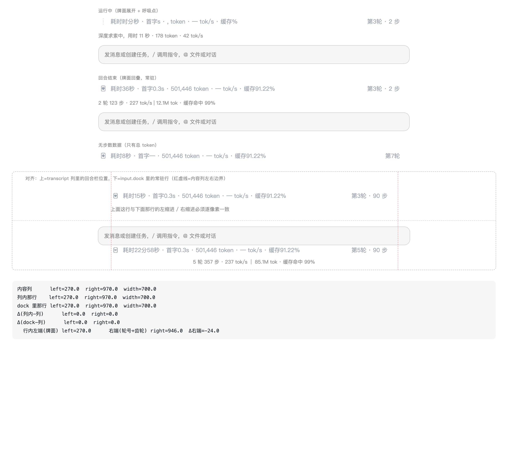

# dsh-turn-stats-footer

给 DeepSeek Harness（DSH）桌面版每条回答加上 **DeepSeek 风格的每轮统计行** ——
轮末一条、输入框上方常驻一条，跑着有、跑完也有，长回合不用往回翻：

```
① 轮末（每轮回答最下方）：
   第2轮 · 耗时20分4秒 · 首字2.5s · 4,980,464 token · 71 tok/s · 缓存97.70% · GLM-5.3

② 输入框上方状态行区域（常驻，跑着有/跑完也有；turn-fold 原样移植）：
   [🂠扑克牌] 耗时36秒 · 首字8.1s · 501,446 token · 213 tok/s        第3轮 · 2 步 ⚙
   ────────────────────────────────────────────────────────────────────────
```

运行中左侧牌面按 @winteries/dsh-turn-fold 原版动画绕轴旋转 + 花色轮换，跑完回落到静态牌堆；
齿轮点开是同一套字段开关（与 turn-fold 共用存储，两处联动）。

## 是什么

[@winteries/dsh-turn-fold](https://github.com/Winter-And-You-Gone/dsh-turn-fold)
把回合统计条放在每轮**开头**（turn-process 渲染器）。本插件做两件事：

1. **轮末统计行**：同口径统计放到每轮**末尾**（shadow 官方 `turn-tail` 渲染器，
   官方操作按钮行/用量行原样保留，统计行垫底）。
2. **「本轮」常驻行**：写在 `conversation.input.dock`（输入框卡片**上方**那条整行，
   也就是“执行中…/用时 N 秒”状态行所在的同一区域，order -10 排在最前）。
   **跑着有、跑完也有**：回合运行中每秒刷新（耗时吃实时墙钟），
   回合结束后保留结算值（耗时吃 `TurnLocation.end`）。
   **外观与交互 100% 来自 turn-fold 源码移植**（见 `client.js` 顶部 `TF` 块）：
   - 同一套 CSS（`.ccg-*`，含 `.ccg-roll-*` 滚轮里程表、`.ccg-poker-*` 牌面）
   - 同一个牌面渲染器 `buildPokerSVGBase`/`PokerIcon`（真扑克 5:7、纯描边 + 花色 pip、
     mask 遮挡开合动画、DeepSeek 鲸鱼顶牌）
   - 同一个 `TurnBarView`（图标 + 指标 + 右端 `第N轮 · M 步` + 齿轮 + 底部 1px 分隔线）
   - 同一个 `SettingsDialog`（5 个字段开关 + 图标风格 poker/native）
   - **同一份设置存储** `localStorage dsh-turn-fold:settings` —— 两处开关联动：
     在本条齿轮里关掉「首字」，顶部回合栏与这条同时隐藏
   - 运行中数字是**滚轮里程表**（真实数据变化才滚动，不伪造增长）
   - 运行中牌面 = 原版 **`PokerSpinIcon`**：绕竖直对角轴（35.54°）1.6s 一循环的 SMIL 旋转，
     牌面 6.4s 轮换 spade/heart/diamond/club 与 DeepSeek 鲸鱼牌背；回合跑完才回落到静态牌堆/扇形
     （`turnPokerIcon(..., running, ...)` 必须传真实 running —— 传 false 就是"图标杵着不动"）
   - 对齐：官方 transcript 节点是 `._1kaiZa_column{max-width:var(--dsh-chat-content-width);width:100%;margin:0 auto}`
     这一层列盒子；而 `input.dock` 容器是**整条面板宽度**。所以本条自己套一层同款列盒子
     （`width:100%; max-width:var(--dsh-chat-content-width); margin:0 auto`），
     左缩进 / 右缩进与顶部回合栏**逐像素重合**（离线量尺：Δleft=0.0 Δright=0.0，见预览页底部读数）

看完结论不用再往上滑，长回合中也不必来回翻。

## 数据口径（全部官方真实数据）

- 第N轮 / 耗时：`TurnLocation.start/end.time`（durable，历史回看仍在）；
  ②运行中取 start→now 实时墙钟，结束后取 start→end
- 总 token / 缓存 / 模型：`TurnTailChatData.tokenUsage` 官方精确聚合
  （缓存命中率分母 = prompt 侧 = totalTokens − outputTokens，TurnUsagePanel 同款）
- 步数：本回合 assistant-step 成员数（官方 `ChatNodeStore.turnDataSource`，含隐藏节点）
- 指标聚合：直接调用移植进来的 turn-fold `computeTurnMetrics` / `turnHeaderLabel`
  / `filterVisibleMetrics`（与顶部回合栏同一套代码，口径不可能漂移）
- 首字(TTFT) / tok/s：优先 turn-fold 注册的官方投影 `turnFoldMetrics`
  （落盘事件折叠，reload/历史会话仍准确）；未装 turn-fold 时回退客户端
  `assistant-step` 的 `finalNode.timing` 聚合（官方 `assistantStepReading` 谓词，
  历史重建时为 null → 该字段省略）。tok/s = Σoutput ÷ Σdecode（decode 口径）。
- ②只累计真实已有数据（当前 step 一旦拿到 usage/timing 即计入），不伪造增长。

## 预览（不需要 DSH）

静态渲染三种状态，可直接用浏览器打开，或截图看效果：

```sh
open tests/preview/index.html
# 无头截图：
"/Applications/Google Chrome.app/Contents/MacOS/Google Chrome" --headless=new \
  --window-size=820,560 --screenshot=/tmp/preview.png file://$PWD/tests/preview/index.html
```

## 设置

`localStorage` 键 `dsh-turn-stats-footer:composerLine`：

| 值 | 行为 |
| --- | --- |
| 缺省 / `input` | 输入框**上方**状态行区域（`conversation.input.dock`）——默认，与顶部回合栏对齐 |
| `dock` / `below` | 改挂输入框**下方**统计带（`conversation.composer.dock`） |
| `0` / `off` | 关闭②，只留轮末统计行 |

改完刷新页面即可；不想刷新就在控制台执行 `__DSH_TURN_STATS_FOOTER__.reinstall()` 按当前设置重挂。

对齐基准（`localStorage` 键 `dsh-turn-stats-footer:align`）：

| 值 | 行为 |
| --- | --- |
| 缺省 / `content` | 聊天内容列 = 顶部回合栏那一列（`--dsh-chat-content-width`）——默认 |
| `card` / `composer` | 输入框卡片宽度（`--dsh-composer-card-max-width`） |
| `pane` / `full` | 整条面板宽度（不给左右缩进） |

控制台切换（立即生效，不用刷新）：

```js
__DSH_TURN_STATS_FOOTER__.setAlign('card')   // 'content' | 'card' | 'pane'
__DSH_TURN_STATS_FOOTER__.alignInfo()        // 现场量尺：本条盒子 vs 顶部回合栏所在列，delta 应为 0
```

## 离线自测

```sh
node tests/harness.test.mjs   # 假宿主：装载 + 两处渲染 + 常驻/位置开关/对齐盒子/兜底路径
```

`tests/preview/index.html` 除三种状态外，还带**对齐验证面板**：把同一行分别放进
「transcript 内容列」和「整条面板宽的 input.dock」里，画红虚线标出内容列左右边界，
并在页面底部打印实测盒子与 Δ（当前 Δleft=0.0 Δright=0.0）。

## 安装 / 更新 / 卸载（桌面版 profile，官方通道）

```sh
# 从 GitHub 取源码（放到官方插件目录）
git clone https://github.com/HuaiPengFei666/dsh-turn-stats-footer.git ~/.dsh/plugins/dsh-turn-stats-footer

# 装 / 改完源码后重装（pnpm link: 依赖，源码目录即生效）
DSH_HOME=~/.dsh-official node ~/.dsh-official-app/node_modules/.bin/dsh plugin --profile desktop add ~/.dsh/plugins/dsh-turn-stats-footer
# ↑ 会被 CLI 的 desktop 守卫拒绝时，用 runCli({manageDesktopProfile:true}) 等价通道

# 卸载
dsh plugin --profile desktop remove dsh-turn-stats-footer   # 同上走官方通道
```

装完刷新页面（Cmd+R）；宿主按包名缓存 bundle，刷新拿不到新代码时完全重启 DSH。

## 预览



运行中旋转牌的四帧对照见 [tests/preview/spin-frames.png](tests/preview/spin-frames.png)。

## 兼容性

- 开发验证宿主：DSH 桌面版 0.2.0-rc.2 / 0.2.1-alpha.1（dsh-base + dsh-web-app bundle）。
- 移植基线：`@winteries/dsh-turn-fold` 0.6.0（`client.js` + `icons/default.json`）。
  升级 turn-fold 后如需同步外观，重新按同样方式移植即可。
- 齿轮设置与 turn-fold **共用同一个 localStorage 键**，所以两处联动是设计行为。
- 宿主数据面缺失时全部静默降级：拿不到 `useConversation`/`useChat` 就不显示②，
  拿不到 turn-tail 官方渲染器就不注册①，官方 UI 无损。
- 依赖 turn-fold 存在的只有 durable TTFT/tok-s（缺省自动降级，不报错）。

## 许可

[MIT](LICENSE) © 2026 HuaiPengFei666。

`client.js` 里的 `TF` 块（turn-fold 的 CSS、扑克牌几何/花色 path、`TurnBarView`、
`SettingsDialog`、指标聚合、图标配置）是从
[@winteries/dsh-turn-fold](https://github.com/Winter-And-You-Gone/dsh-turn-fold)
（MIT，© dsh-turn-fold contributors）**原样移植**的，完整范围与原始许可见
[NOTICE.md](NOTICE.md)。
